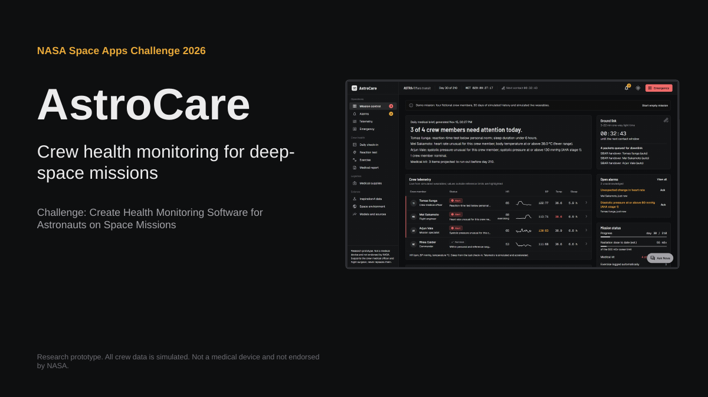
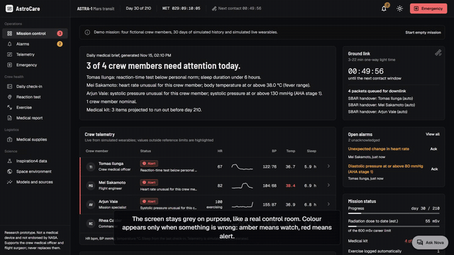

<div align="center">



# 🛰️ AstroCare

### Explainable, offline-first health monitoring for deep-space crews

**NASA Space Apps Challenge 2026** · **Create Health Monitoring Software for Astronauts on Space Missions**

**Real research data · Personalised monitoring · Automated alerts · Delay-aware communication**

[🎬 **Watch the Demo**](media/AstroCare-demo.mp4) &nbsp;·&nbsp; [📊 **View the Presentation**](presentation/AstroCare_Presentation.pdf) &nbsp;·&nbsp; [📥 **Download PowerPoint**](presentation/AstroCare_Presentation.pptx) &nbsp;·&nbsp; [💻 **Run Locally**](#-quick-start)

</div>

> [!IMPORTANT]
> **Research prototype — not a medical device.** AstroCare's demo crew, live telemetry, alarms, and medical events are **simulated**. The project is an independent NASA Space Apps Challenge submission; **NASA has not endorsed or clinically validated it**. The app supports human review and does not diagnose or prescribe treatment.

## 🌌 The mission

During a deep-space mission, crews cannot rely on real-time clinical support or resupply. A Mars communication delay can approach **22 minutes one way**. Crew members need a tool that watches for meaningful changes, explains why something is unusual, and prepares the information needed for a delayed consultation with Earth.

**AstroCare turns continuous health observations into a prioritised, explainable mission-health picture.** Instead of judging every astronaut against one population average, it also learns each crew member's personal baseline and detects gradual changes that a single reading might miss.

## 🎬 See AstroCare in action

<div align="center">

<a href="media/AstroCare-demo.mp4"></a>

*Click the animated preview to open the full ~91-second demonstration.*

**[▶ Open full demo video](media/AstroCare-demo.mp4)** &nbsp; | &nbsp; **[📊 View all 13 slides](presentation/AstroCare_Presentation.pdf)** &nbsp; | &nbsp; **[⬇️ Get editable slides](presentation/AstroCare_Presentation.pptx)**

</div>

## ✨ What makes AstroCare different

| Capability | What it brings to the mission |
| :--- | :--- |
| 🧑‍🚀 **Whole-crew mission console** | One view of crew status, current observations, trends, alarms, and priorities. |
| ❤️ **Continuous simulated telemetry** | Background heart-rate, blood-pressure, and temperature streams with browser-side forecasts. |
| 📈 **Individual baselines & drift detection** | Robust personal baselines and Theil–Sen trends can highlight changes before population limits are crossed. |
| 🚨 **Explainable alerts** | Alarms identify the exact rule: reference limit, personal deviation, trend, expected-range violation, or sensor dropout. |
| 🧠 **Cognitive performance tracking** | An interactive psychomotor vigilance test (PVT-B) compares reaction performance against a crew member's own history. |
| 🏋️ **Exercise countermeasures** | Activity detection, exercise logs, and prescription-compliance tracking support deconditioning monitoring. |
| 🩺 **Daily health check-ins** | Wearable averages and sleep estimates pre-fill entries for crew review and symptom reporting. |
| 💊 **Supply forecasting** | Usage and expiry projections flag potential medical-kit shortages before mission end; **no dosing advice**. |
| 🛰️ **Delayed Earth handovers** | Structured **SBAR** reports and an outbox queue information for the next ground-contact window. |
| 🔬 **Spaceflight biomarkers** | Visualises the real **NASA OSDR OSD-575 / Inspiration4** blood-chemistry dataset against each person's baseline. |
| 🤖 **Nova evidence assistant** | Source-citing, local **BM25 retrieval** answers from a curated knowledge base and abstains when evidence is insufficient. |
| 📡 **Offline-first operation** | Local IndexedDB persistence and service-worker support, with an optional FastAPI/SQLite sync service. |

## 🧬 How the monitoring works

```text
Simulated wearables + crew check-ins
                 │
                 ▼
     Reference limits + personal baseline
                 │
                 ▼
      Slow-drift + forecast-band checks
                 │
                 ▼
       Explainable Watch / Alert flags
                 │
                 ▼
    Medical brief + prioritised action queue
                 │
                 ▼
        SBAR report + ground-link outbox
```

AstroCare combines **four interpretable layers** rather than treating a model prediction as a diagnosis:

1. **Reference ranges:** published adult ranges from medical sources such as AHA, MedlinePlus, and CDC.
2. **Personal baseline:** each crew member's first 10 check-ins establish a robust median and spread (MAD).
3. **Longitudinal trend:** a Theil–Sen slope across recent readings detects gradual drift.
4. **Expected-range forecast:** gradient-boosted models trained on PhysioNet data produce a **split-conformal 90% expected range** for the next reading.

Every flag is traceable to its triggering rule. The crew medical officer remains responsible for interpreting and acting on findings.

## 📊 Grounded in real datasets — transparent about performance

The app's **astronaut scenarios are fictional**, while its research and modelling components use real open datasets:

| Source | Role in AstroCare |
| :--- | :--- |
| **PhysioNet / Computing in Cardiology Challenge 2012** | Earth ICU vital-sign data for the browser-compatible prediction models; **8,000 stays** used for training in the reported workflow. |
| **CDC NHANES 2017–2018** | Additional physiological data evaluated in the research pipeline. |
| **NASA Open Science Data Repository, OSD-575** | Inspiration4 blood chemistry: **4 crew × 7 timepoints × 16 analytes**, shown as a research visualisation. |
| **NASA Human Research Program & CSA resources** | The five hazards, remote-care context, radiation planning, and other mission-oriented evidence. |

### Reported model evaluation

| Vital sign | Test MAE | Naive baseline MAE | Use in the app |
| :--- | ---: | ---: | :--- |
| Heart rate | **4.85 bpm** | 4.97 bpm | Live expected band |
| Systolic blood pressure | **9.70 mmHg** | 10.59 mmHg | Live expected band |
| Diastolic blood pressure | **7.52 mmHg** | 8.65 mmHg | Live expected band |
| Temperature | **0.27 °C** | 0.29 °C | Live expected band |
| Glucose | 32.0 mg/dL | 36.5 mg/dL | **Excluded** — weak model (R² 0.14) |
| Sleep | 1.25 h | 1.27 h | **Excluded** — weak model (R² ≈ 0) |

**Heart-rate band coverage:** approximately **90.1%** on held-out readings for the nominal 90% band, as reported in the project presentation. Improvements in point prediction are modest; calibrated uncertainty and interpretable deviations are the principal research contributions.

> [!CAUTION]
> Models were trained and evaluated on **Earth-based populations**, not operational astronauts. These ranges are **not flight-medical thresholds**. Independent validation, recalibration on suitable astronaut or analog-mission data, sensor verification, and flight-medicine review would be required before any real-world deployment.

## 👨‍🚀 Explore the demo mission

The built-in demonstration follows **four fictional astronauts over 30 days**:

- 🟢 **Commander:** stable observations throughout the mission.
- 😴 **Medical officer:** worsening sleep and slower reaction-time performance.
- 🌡️ **Engineer:** fever onset, reduced exercise, and increased supply consumption.
- 📉 **Specialist:** gradually increasing blood pressure with low exercise compliance.

These scenarios are used to exercise alarm logic, longitudinal monitoring, forecasts, reports, and mission-planning workflows.

## 🛠️ Technology stack

| Layer | Technology |
| :--- | :--- |
| **Frontend** | React 19, TypeScript, Material UI (MUI), DataGrid |
| **Visual system** | Greyscale control-room interface; amber = Watch, red = Alert; dark/light modes |
| **Analytics** | Robust statistics, Theil–Sen trends, gradient-boosted trees, split-conformal prediction |
| **Research pipeline** | Python, scikit-learn, PhysioNet / NHANES evaluation |
| **Knowledge assistant** | Local BM25-based retrieval using `src/rag.mjs` and `public/knowledge-base.json` |
| **Local data** | IndexedDB, service worker |
| **Optional API** | FastAPI, SQLite |

## 🚀 Quick start

**Requirements:** Node.js **20.19+** (tested on Node 24), and Python **3.11+** only if using the optional API or research pipeline.

```bash
npm install
npm run dev
```

Open **http://127.0.0.1:5173**, then click **Load demo crew**.

<details>
<summary><strong>Optional: Run the local FastAPI sync server (Windows)</strong></summary>

```powershell
python -m venv .venv
.\.venv\Scripts\python.exe -m pip install -r backend\requirements.txt
.\.venv\Scripts\python.exe -m uvicorn backend.main:app --host 127.0.0.1 --port 8000
```

</details>

<details>
<summary><strong>Build and preview a production bundle</strong></summary>

```bash
npm run build
npm run preview
```

The output in `dist/` is a static build; the optional Python server is not required to view the demo. Without it, data remains in the current browser's local storage.

</details>

<details>
<summary><strong>Run tests and reproduce the research models (Windows)</strong></summary>

```powershell
# Application tests (42 tests reported in the project)
npm test

# Optional FastAPI tests
.\.venv\Scripts\python.exe -m pytest backend -q

# Research environment and training
python -m venv .research-venv
.\.research-venv\Scripts\python.exe -m pip install -r research\requirements.txt
.\.research-venv\Scripts\python.exe research\train.py
.\.research-venv\Scripts\python.exe research\export_models.py
.\.research-venv\Scripts\python.exe -m pytest research\test_pipeline.py -q
```

The project also checks browser-side tree evaluation against scikit-learn to within `1e-6` using `tests/models.test.mjs`.

</details>

## 🧭 Roadmap to responsible deployment

- 🔍 Recalibrate and independently test on astronaut or analog-mission data.
- 🩺 Establish thresholds and workflows with flight-medicine specialists.
- 📟 Validate wearable sensors and measurement quality.
- 🔐 Add identity, access controls, encryption, and secure delay-tolerant sync.
- 🌍 Explore applications in remote clinics, polar stations, maritime expeditions, and other isolated environments.

## 📚 Documentation and attribution

- **[Project presentation (PDF)](presentation/AstroCare_Presentation.pdf)** — 13-slide challenge pitch.
- **[Editable presentation (PPTX)](presentation/AstroCare_Presentation.pptx)** — original slide deck.
- **[Full demonstration (MP4)](media/AstroCare-demo.mp4)** — feature walkthrough.
- **[`science.json`](science.json)** — scientific references and resource mapping in the application.
- **[`LICENSES_AND_ATTRIBUTION.md`](LICENSES_AND_ATTRIBUTION.md)** — dataset and dependency attribution.
- **[`docs/SENIOR_REVIEW.md`](docs/SENIOR_REVIEW.md)** — detailed limitations and review notes.

---

<div align="center">

### 🌍 Built for exploration. Designed around evidence.

**AstroCare · NASA Space Apps Challenge 2026**

*Independent research prototype. Simulated crew data. Human-led decisions.*

</div>
